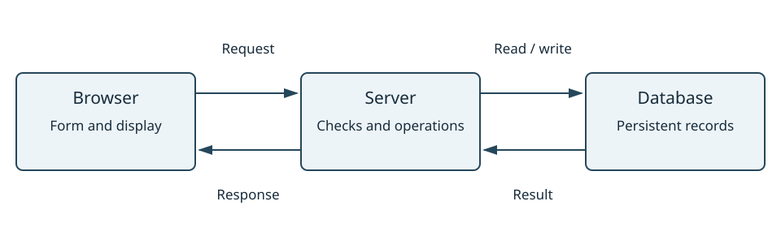

:::::::::::::::::::::::::::::::::::::::: questions

- What happens between clicking a button and seeing a result?
- What runs in the browser, what runs on a server, and where is data stored?
- What must we specify before asking an AI to build an application for other people?

::::::::::::::::::::::::::::::::::::::::

:::::::::::::::::::::::::::::::::::::::: objectives

- Assign browser, front-end, back-end, server, and database responsibilities.
- Trace an HTTP request and response using browser tools or a prepared transcript.
- Distinguish in-memory state, browser storage, and server-side persistent storage.
- Separate authentication from authorisation and identify checks that belong on a server.
- Specify a small shared application, including storage, access, and failure checks.

::::::::::::::::::::::::::::::::::::::::

## From a working page to a working system

In [Topic 2](02-What-AI-Is-Building.md), we followed a value through code. In
[Topic 3](03-Data-File-StructuredInfo.md), we described records and file formats.
Now we follow a record through a web application.

An application can look convincing while saving nothing, keeping data only in
one browser, or allowing the wrong people to change records. "Build me an app"
leaves these choices open. Knowing the parts helps us specify and investigate them.

Use the activity tracker from the [setup instructions](../learners/setup.md).
It begins with the same three synthetic research activities used in Topic 3.
It runs on your laptop with a small Python server and a SQLite database. You do
not need to read the Python implementation or write database queries today.

| Block | Explanation and demonstration | Exercises | Total |
| --- | ---: | ---: | ---: |
| Identify the parts | 15 min | 20 min | 35 min |
| Follow a request | 15 min | 25 min | 40 min |
| Locate state and storage | 20 min | 20 min | 40 min |
| Specify access and sharing | 15 min | 20 min | 35 min |

Take a break after the second block. Break time is additional to these estimates.

## 1. Identify the parts

The **client** requests something from another program. Here the client is a
web **browser**. The **front end** is the part users interact with in the browser.
HTML describes structure, CSS controls presentation, and JavaScript can respond
to actions and request data.

A **server** is a program that receives requests and sends responses; we also
use the word for the computer running it. The **back end** carries out server-side
work, such as checking a submitted record and deciding whether to save it.

A **database** stores organised data and supports operations to retrieve and
change it. Our database is a SQLite file used by the back end. The browser does
not open that file directly: it asks the server to perform an operation.



The same laptop can run both browser and server. These are still separate
programs with separate responsibilities. In a deployed application, the server
will often run on a different computer.

### Compare our two examples

| Responsibility | Task manager | Activity tracker |
| --- | --- | --- |
| Download page, styles, and JavaScript | Local teaching server | Local teaching server |
| Respond to form submission | Browser JavaScript | Browser JavaScript |
| Validate input | Browser | Browser checks plus server validation |
| Store records | This browser's `localStorage` | SQLite file used by the server |
| Obtain records | Read browser storage | Request records from the server |

The task manager uses a server to obtain its files, but its task operations run
entirely in the browser. It does not send tasks to the activity API. A browser
application does not always need a data back end or database server.

:::::::::::::::::::::::::::::::::::::::: challenge

### Who does this job? (10 minutes)

Assign each job to the browser/front end, back end, or database. Some operations
involve more than one part: explain the hand-off.

1. Display a Save button.
2. Send a proposed activity and its hours.
3. Reject a record with hours greater than 24, even if browser checks are bypassed.
4. Keep the accepted activity after the server restarts.
5. Display the saved activity in the list.

:::::::::::::::::::::::::::::::::::::::: solution

1. Browser/front end. 2. Browser sends a request to the back end.
3. Back end validates before writing. 4. Back end writes to persistent database
storage; the database file survives this server restart. 5. Browser uses returned
records to update the display. Storing a record does not itself redraw a page.

::::::::::::::::::::::::::::::::::::::::
::::::::::::::::::::::::::::::::::::::::

:::::::::::::::::::::::::::::::::::::::: challenge

### Draw the data journey (10 minutes)

Draw three boxes: browser, server, database. A researcher enters `Read methods`
and `1.5` hours, then clicks Save. Add arrows and labels showing the expected
journey. Where would you look if the activity was saved but did not appear?

Compare with a partner. Can you explain each arrow without saying "the app
does it"?

:::::::::::::::::::::::::::::::::::::::: solution

Browser sends proposed record -> server validates -> server writes database ->
server confirms save -> browser requests the updated list -> server reads the
database and responds -> browser displays records.

This supplied implementation uses a second request to reload the list after
saving. Other implementations might update the display from the save response.
For a saved-but-invisible record, inspect list loading and display as well as the
save response; gather evidence before choosing a cause.

::::::::::::::::::::::::::::::::::::::::
::::::::::::::::::::::::::::::::::::::::

## 2. Follow a request and response

**HTTP** is a protocol: rules for requests and responses between clients and
servers. **HTTPS** protects that communication in transit using encryption and
server identity checks. Our loopback teaching example uses HTTP locally.

Consider this address:

```text
http://127.0.0.1:8000/api/activities
|      |         |    |
scheme host      port path
```

`127.0.0.1` is a loopback address: this computer. `localhost` is a name commonly
used for a loopback address. Keep using the same address and port during the
exercises, because browser storage is associated with the page's **origin**
(scheme, host, and port). `localhost` and `127.0.0.1` are different hosts to the browser.

A **route** connects a request's method and path to server behaviour.
An **API** is an agreed interface through which software requests operations.
Our small HTTP API has these routes:

| Method and path | Meaning in this app | Successful response |
| --- | --- | --- |
| `GET /api/activities` | Retrieve activity records | `200` and a JSON array |
| `POST /api/activities` | Submit a new activity | `201` and the saved JSON record |

The names and meanings of these routes are choices made by this application.
Not every API has these paths, and not every API is accessed over HTTP.

### Read a request

```http
POST /api/activities HTTP/1.1
Content-Type: application/json

{"activity": "Read methods", "hours": 1.5}
```

The **method** describes the requested operation. **Headers** describe aspects
of the message; `Content-Type` identifies the representation of its **body**.
Here the body is JSON, connecting to Topic 3. The browser sends a number for
hours, not the string `"1.5"`.

An illustrative response is:

```http
HTTP/1.0 201 Created
Content-Type: application/json; charset=utf-8

{"id": 104, "activity": "Read methods", "hours": 1.5, "completed": false}
```

The new ID depends on existing records; do not expect 104 if you have already
added activities. The server assigns the ID and sets new records to incomplete.

| Status | Interpretation | In the supplied app? |
| --- | --- | --- |
| `200 OK` | Request succeeded | Yes, loading records |
| `201 Created` | New resource created | Yes, saving a valid record |
| `400 Bad Request` | Submitted request is invalid | Yes, failed validation |
| `404 Not Found` | No resource at that address | Yes, an unknown route |
| `500 Internal Server Error` | Server encountered an unexpected problem | General example; no deliberate 500 exercise |

An HTTP failure response still means a server responded. A connection failure
may produce no HTTP status because no response arrived. Also, browser `fetch`
does not treat every error status as a thrown exception: code must check the
response status. The supplied front end checks `response.ok`.

:::::::::::::::::::::::::::::::::::::::: challenge

### Inspect the exchange (15 minutes)

1. Open the activity tracker. Open browser developer tools using the browser's
   menu (often **More tools** or **Web Developer**), then select **Network**.
2. Select the Fetch/XHR filter if available. Clear existing requests, then click
   **Reload list**. Select the request whose path is `/api/activities`.
3. Record its method, status, and one response record.
4. Enter `Read methods` and `1.5`, then click **Save activity**.
5. Identify the POST and the following GET. Inspect the submitted payload and
   saved record. What extra fields did the server supply?

Use the [worksheet](../learners/worksheet.md). If developer tools are
unavailable, use [request transcripts](../learners/request-transcripts.md). Menu labels
vary; the method, path, status, payload, and response are the important evidence.

:::::::::::::::::::::::::::::::::::::::: solution

Reload produces GET, status 200, and an array. Save produces POST with activity
and numeric hours; status 201 returns an ID and `completed: false` alongside
the submitted values. The following GET retrieves the updated array. The
browser uses that array to redraw the list. Requests for HTML, CSS, and JavaScript
are different from these requests for records.

::::::::::::::::::::::::::::::::::::::::
::::::::::::::::::::::::::::::::::::::::

### Why validate on the server too?

A browser can help people fill out a form, but another client can send requests
without using that form. The server must enforce its own data and access rules.

The supplied form checks required fields and numeric limits. Spaces satisfy
the browser's "required text" check, so the server also checks that the trimmed
description is non-empty. This is the same validation idea we studied in Topic 2.

:::::::::::::::::::::::::::::::::::::::: challenge

### Observe a rejected request (10 minutes)

Enter three spaces for Activity and `1` for Hours, then save. Record the POST
status, response message, visible message, and whether the list gains a record.
Click Reload list to check the stored records.

Explain why a disabled Save button or hidden form would not be enough to enforce
a rule on the server. If you cannot run the example, use transcript B.

:::::::::::::::::::::::::::::::::::::::: solution

The POST returns 400 and `{"error": "Enter an activity description."}`.
The front end displays a request-failed message. No new record is saved; reloading
confirms it is absent. Other clients can submit directly, so browser controls
cannot replace server validation or access checks.

::::::::::::::::::::::::::::::::::::::::
::::::::::::::::::::::::::::::::::::::::

## 3. Locate state and persistent storage

Recall Topic 1's distinction between current **state** and **persistence**.
Information can exist in several places at once:

| Place | Example | What happens on refresh? | Visible to a separate browser? |
| --- | --- | --- | --- |
| Browser memory | JavaScript's current array | Recreated as the page loads | No, by itself |
| Browser storage | Task manager's `localStorage` | Normally available to reload at the same origin | No, not automatically |
| Server memory | An unsaved list held by a server process | Depends on server, not page refresh | Potentially, while server runs |
| Server database file | Activity tracker's SQLite records | Available through another request | Yes, if that browser can reach this server and access is permitted |

Browser storage can outlive closing a normal browser window, but people can
clear it, browsers can restrict it, and private browsing has different lifetime
rules. It is not a backup or a shared team database.

Our SQLite file persists after stopping and restarting the server **when we use
the same database file**. Switching files produces a different set of records.
A persistent file also needs suitable storage and backups in a real deployment;
some hosting environments discard local files when an instance is replaced.

The database is a source of stored records. The browser's displayed list is a
view of records it last retrieved. They can temporarily disagree.

:::::::::::::::::::::::::::::::::::::::: challenge

### Predict, then test persistence (12 minutes)

Add a distinctive task in the task-manager starter and a distinctive activity
in the tracker. Keep the same `127.0.0.1` URL and port throughout.

Predict before each test, then record what you see:

1. Refresh both pages.
2. Open the same two URLs in a separate browser or a separate browser profile
   on this laptop. A second tab in the same profile is not a separate browser.
3. Stop the server with Ctrl+C and restart using the same command and database.
   Return to the original browser and refresh both pages.

Do not close private windows if they hold practice data you still need. If only
one browser is available, use the expected-observations table in the solution.

:::::::::::::::::::::::::::::::::::::::: solution

| Test | Task manager | Activity tracker |
| --- | --- | --- |
| Refresh | Task reloaded from this browser's storage | Activity retrieved from database |
| Separate browser/profile | Original browser's task absent | Saved activity retrieved from same server |
| Server restart, original browser | Task remains in browser storage | Activity remains in same database file |

The server is needed to reload the task-manager code, but does not store its
tasks. These observations establish access from another browser on this laptop;
they do not establish access from a colleague's computer. On their computer,
`127.0.0.1` refers to their own machine.

::::::::::::::::::::::::::::::::::::::::
::::::::::::::::::::::::::::::::::::::::

### Diagnose by following evidence

Before asking an AI to change code, identify the last step supported by evidence.

| Observation | Next useful evidence |
| --- | --- |
| No request follows clicking Save | Browser event handling, form validation, console messages |
| Request receives 400 | Submitted values and server validation response |
| Save receives 201 but new row is absent | Follow-up GET response and display update |
| Reload receives no response | Server process, address, port, connection evidence |
| Data disappears after server restart | Database path and whether the same file is in use |

A 201 response is a claim by the server. In this supplied server it follows a
database commit; in another generated system, inspect or test the implementation
before assuming the same guarantee.

:::::::::::::::::::::::::::::::::::::::: challenge

### Separate save, load, and display failures (8 minutes)

These are prepared scenarios; do not introduce them into your working files.

**A:** A save returns 201. A later GET includes the new record, but the page
does not show it.

**B:** A save returns 400 with a validation message. A later GET excludes it.

**C:** The list worked earlier. After the instructor stops the server, clicking
Reload list fails without an HTTP response.

For each, identify the most useful next investigation and write one sentence
you could give an AI assistant. If time allows, observe C live and restart the
server afterwards. Do not assume these scenarios all have the same cause.

:::::::::::::::::::::::::::::::::::::::: solution

A: inspect front-end rendering and its input; the retrieval response contains
the record. "The POST succeeds and the GET includes record 104, but rendering
omits it; inspect the list-update code using these responses."

B: inspect the submitted payload against the agreed validation rules. "The POST
returns 400; explain which supplied value violates the rule before changing it."

C: check and restart the server, then retry. "No response arrives at this address;
verify that the server is running on the expected port before changing the app."

::::::::::::::::::::::::::::::::::::::::
::::::::::::::::::::::::::::::::::::::::

## 4. Specify access and sharing

### Authentication and authorisation answer different questions

**Authentication** establishes who a user is. **Authorisation** determines what
that user may do. Being signed in does not imply permission to edit every record.
Showing or hiding a button improves the interface, but the server must check
permission before carrying out protected operations.

Our local activity tracker deliberately has **no accounts or access controls**.
Any client that can reach it can read and add records. It demonstrates data flow,
not a ready-made private team service. The following access examples are design
scenarios, not features implemented by the supplied server.

:::::::::::::::::::::::::::::::::::::::: challenge

### Decide access before implementation (5 minutes)

A future shared tracker has these rules: viewers can read records; contributors
can read and add records; only an administrator can delete records.

1. A signed-in viewer requests a deletion. Is authentication or authorisation
   the missing permission?
2. A contributor hides a Delete button in their browser. Has the server's
   deletion rule been enforced?
3. Where should the final permission check happen?

:::::::::::::::::::::::::::::::::::::::: solution

1. The viewer is authenticated but is not authorised to delete.
2. No; browser appearance is not a server access rule.
3. On the server, before deleting. This design also needs a way to establish
identity and associate it with a role; simply accepting a role supplied by a
browser would not establish permission.

::::::::::::::::::::::::::::::::::::::::
::::::::::::::::::::::::::::::::::::::::

### Localhost, domains, hosting, and deployment

A **domain name**, such as `tracker.example.org`, is a human-readable name that
can be resolved to a network address. **Hosting** provides the computing and
network resources that run and serve an application. **Deployment** places a
chosen version, dependencies, and configuration into that environment.

A domain name does not itself provide a running application, persistence, or
access control. Uploading code to a repository does not automatically provide a
running back end either. A static hosting service can serve a browser-only app;
a server-backed app additionally needs somewhere to run its back end and keep
its data. The supplied Python teaching server listens only on this laptop and
is not a production deployment recipe.

Ask these questions when changing "an app for me" into "an app for our team":

- Who needs access, from which computers, and what may each person do?
- Which records must be shared and persist, and where will they be stored?
- Which checks and credentials must remain on the server?
- What should happen when saving or loading fails?
- Who will host, update, and back up the application?

### Turn requirements into checks

Compare:

> Build a dashboard for our activities.

with:

> Propose a small shared research-activity tracker before implementing it.
> Contributors can add activities with a meaningful description and numeric hours
> greater than 0 and at most 24. Viewers can read but cannot add records. Enforce
> data and access rules on the server. Save accepted records in persistent storage;
> they must remain after restarting the back end. Show a clear failure message if
> saving fails, and preserve the entered values for retry. Explain the browser,
> server, storage, identity, and hosting choices. Give checks from two browser
> profiles, including rejected input and denied access. Identify assumptions
> before writing code.

The role and hosting requirements extend our demonstration. An AI should explain
those missing parts rather than claim the local demo already satisfies them.

:::::::::::::::::::::::::::::::::::::::: challenge

### Final challenge: specify and assess an app (15 minutes)

Work alone first, then exchange plans with a partner. For a shared reading-list
or research-activity tracker:

1. Draw browser, server, and storage, labelling the data exchanged.
2. Define inputs and validation rules. Use Topic 3's fields and types if helpful.
3. Describe who can read and who can change records.
4. Say what must survive a refresh, a server restart, and access from another
   authorised browser.
5. Specify the visible result of success and of a failed save.
6. Write three acceptance checks, including one failure case.

Then write a request to an AI assistant that includes those decisions. You do
not need to generate or deploy the whole application to complete this challenge.
During the separate practice period, an instructor may demonstrate one small
change after reviewing its scope with the group.

:::::::::::::::::::::::::::::::::::::::: solution

One possible plan uses a browser form, a server API with server-side validation
and permission checks, and a persistent database. A real identity mechanism
establishes whether a user is a viewer or contributor. The browser receives
records it may display; private credentials remain on the server.

Example checks:

1. A contributor saves a valid record. Its returned ID can be found after a
   server restart and from another authorised browser.
2. A spaces-only description is rejected by the server without changing the
   database; the user sees a useful message.
3. A viewer's direct add request is denied by the server, even if the browser
   interface is modified. No record is added.

An additional failure check stops the server before a save. The page should
report failure, preserve input for retry, and avoid claiming the record was saved.
The supplied demonstration already preserves the form on a failed POST, but
does not implement the roles in this proposed plan.

::::::::::::::::::::::::::::::::::::::::
::::::::::::::::::::::::::::::::::::::::

:::::::::::::::::::::::::::::::::::::::: instructor

### Delivery notes

Use the four timing blocks above, with a break after request inspection. The
challenge allocations include feedback. Keep the server running for both
examples; restarting with the same database must preserve added records.

Demonstrate developer tools slowly, enlarge their text, and name the selected
request before switching panels. Accept the request transcripts as equivalent
evidence for learners who cannot use developer tools. No SQL, framework setup,
public hosting account, or authentication implementation is required.

Watch for: the browser is the whole app; a success message proves saving;
localStorage is shared; refreshing restarts the server; a database must run on a
separate machine; a domain provides hosting; hiding a button authorises access.

The final challenge is a design assessment. Keep deployment and full login
implementation as extensions. During the daily reflection, ask learners to
explain the journey from clicking Save to the displayed result in their own
words. See the [shared instructor notes](../instructors/instructor-notes.md).

::::::::::::::::::::::::::::::::::::::::

:::::::::::::::::::::::::::::::::::::::: keypoints

- Browser, server, and database have distinct responsibilities, even on one laptop.
- HTTP requests have methods, addresses, headers, and sometimes a body; responses include statuses and data.
- Saving, retrieving, and displaying records are separate steps that need separate evidence.
- Browser storage is local to a browser and origin; shared data requires an appropriate shared service.
- Authentication establishes identity; authorisation controls allowed actions on the server.
- A shared-app specification includes validation, persistence, access, failure behaviour, and hosting assumptions.

::::::::::::::::::::::::::::::::::::::::

## Further reading

- [MDN: HTTP overview](https://developer.mozilla.org/en-US/docs/Web/HTTP/Guides/Overview).
- [MDN: Using Fetch](https://developer.mozilla.org/en-US/docs/Web/API/Fetch_API/Using_Fetch).
- [MDN: Browser localStorage](https://developer.mozilla.org/en-US/docs/Web/API/Window/localStorage).
